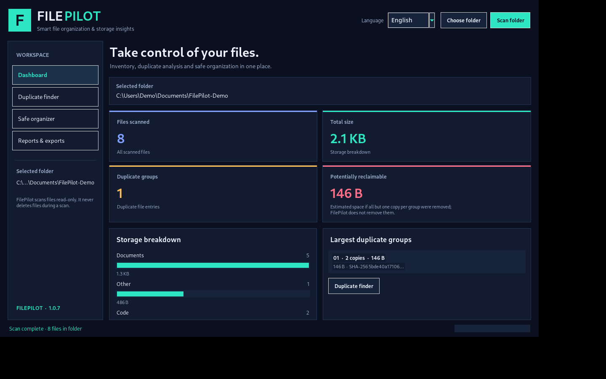

# FilePilot Pro

**A polished bilingual desktop tool for file inventory, duplicate detection, storage analysis, safe organization, and report export.**

FilePilot is built with Python and Tkinter. The first release targets Windows desktop use and processes files locally. It does not upload files or hashes to an online service.

- **Version:** 1.0.7
- **Interface:** English and Persian
- **Core:** Python standard library + Tkinter
- **Optional Persian/RTL rendering:** `arabic-reshaper` and `python-bidi` (installed by `install_dependencies.bat`)
- **Automated tests:** `python -m unittest discover -s tests -v`
- **Default behavior:** scanning is read-only; no files are deleted



## Screens and capabilities

### 1. Dashboard
- Recursive file inventory for the selected folder
- Total size and file-count cards
- Duplicate-group and potential-reclaimable-space summary
- Storage breakdown by file category
- Largest duplicate groups
- Scan progress and warning counts

### 2. Duplicate finder
- Detects identical content using SHA-256, not file names alone
- Lists each matching path, file size, and hash prefix
- Shows potential space savings if all but one copy per group were removed
- Copy a path or open the selected file's containing folder
- Does **not** delete duplicate files

The scanner groups files by size first and hashes only same-size candidates. This avoids reading every file's contents when there are no same-sized candidates. Hashing may still take time on folders with many large files.

### 3. Safe organizer
- Builds a preview before moving anything
- Categorizes root-level files into `Images`, `Videos`, `Audio`, `Documents`, `Spreadsheets`, `Presentations`, `Archives`, `Code`, `Installers`, `Fonts`, or `Other`
- Only proposes moves for regular files directly inside the selected folder; it does not move folders or recursively reorganize nested contents
- If a destination filename already exists, it picks a unique name rather than overwriting it
- Records completed moves in a local operation journal
- Supports undoing the latest FilePilot organization operation without overwriting a file recreated at an original path

**Safety note:** Apply moves only after reading the preview. For the first run, use the provided `demo_data` folder. FilePilot does not permanently delete files, but file movement can still affect workflows; keep backups of important data.

### 4. Reports and exports
- CSV inventory export (UTF-8 with BOM for spreadsheet compatibility)
- JSON inventory and duplicate-summary export
- Standalone HTML report with a dark theme, metrics, categories, duplicate paths, file inventory, and scan warnings

Reports include local paths to make them useful for troubleshooting. Review them before sharing, as paths may reveal usernames or folder structure.

## Quick start on Windows

1. Install Python 3.10 or newer from the official Python website. The Windows installer should include Tcl/Tk.
2. Extract this package to a folder you control, for example `D:\Majid-Ai-Dev\Projects\FilePilot`.
3. Double-click **`install_dependencies.bat`**. It installs the small optional dependencies used for Persian right-to-left text shaping, then launches FilePilot. Internet access is needed for this step. If the install cannot access PyPI, the app can still run in English by launching `run_filepilot.bat`.
4. Select the included `demo_data` folder for your first scan.
5. Click **Scan folder**. The scan should find `meeting_notes.txt` and `meeting_notes_copy.txt` as one identical-content group.
6. Open **Safe organizer** and build a preview. Read the proposed actions before applying any moves. Because demo data is disposable, you can also try **Undo latest organization**.

### Run directly

```bat
python main.py
```

English mode needs no pip packages. To render Persian text correctly, install the optional requirements:

```bat
python -m pip install -r requirements.txt
```

Then restart FilePilot and select Persian.

### Run the tests

```bat
python -m unittest discover -s tests -v
```

Or double-click `run_tests.bat` on Windows.

## File structure

```text
FilePilot_Pro/
├── main.py
├── run_filepilot.bat
├── install_dependencies.bat
├── run_tests.bat
├── requirements.txt
├── README.md
├── filepilot/
│   ├── __init__.py
│   ├── app.py
│   ├── core.py
│   └── i18n.py
├── tests/
│   ├── test_core.py
│   └── test_i18n.py
├── demo_data/
│   ├── README.md
│   ├── brief.md
│   ├── meeting_notes.txt
│   ├── meeting_notes_copy.txt
│   ├── project.json
│   ├── sample_script.py
│   └── nested/
│       └── nested_example.txt
└── docs/
    ├── QUICK_START_FA.md
    ├── SAFETY.md
    └── dashboard-preview.png
```

## Design and implementation notes

- Tkinter/ttk UI with a dark navy theme and teal accents
- Long-running scanning, hashing, moving, and undo operations run in worker threads so the interface remains responsive
- A thread-safe queue delivers progress updates to the UI
- `os.walk(..., followlinks=False)` is used for recursive scanning; symbolic links are skipped
- `.filepilot` directories are excluded from scanning
- SHA-256 is computed for same-size candidate files; same size alone is not treated as a duplicate match
- Organization moves are journaled under the user's local application-data directory, separate from the scanned folder
- CSV, JSON, and HTML exporters work locally
- Tests cover scanning, duplicate detection, preview boundaries, collision-safe moves, undo safeguards, exports, and localization

## Known limitations

- The organizer currently proposes moves only for top-level regular files. This is intentionally safer for the first release and does not reorganize a nested directory tree.
- Duplicate detection can take time if many large files have identical sizes.
- File metadata can change between scanning and applying a plan. The app validates each source path before moving it, but users should still inspect the preview.
- Undo is a best-effort operation. If an original path has been recreated or a moved file is missing, FilePilot will not overwrite existing files and may report that some items could not be restored.
- HTML and CSV reports may include full local paths.
- This is a local desktop utility, not a cloud backup product, antivirus, or filesystem repair tool.

## License and portfolio use

This package is provided for evaluation and portfolio demonstration. No open-source license is granted by this package. All rights are reserved by the author unless a separate written agreement states otherwise. Review, modification, redistribution, or commercial deployment beyond applicable legal exceptions requires the author's prior written permission.

For custom desktop tools, local workflow automation, file-processing utilities, or tailored reporting projects, use this codebase as an example of the author's engineering approach rather than assuming the packaged application is a commercial license.


## Version 1.0.3 UI and portability fixes

- Preserve pure Latin values, byte units, hashes, and native file paths without RTL shaping.
- Move the sidebar and dashboard reading order to the right-to-left side when Persian is selected.
- Use a responsive two-column metric layout to avoid horizontal clipping on DPI-scaled Windows displays.
- Reduce duplicate and organizer table widths and remove the hidden Treeview column's default width.
- Show clear next-step empty states when no folder has been selected or no organizer preview has been built.
- Keep the HTML export test portable to Windows by using a valid filename containing `&`.


## Version 1.0.5 RTL readability fixes

- Split the organizer safety notice into independent short lines so RTL punctuation cannot reorder the entire paragraph.
- Shortened the organizer subtitle to one clear sentence.
- Removed the decorative bullet from the footer status text to avoid bidi marker displacement.
- Kept status labels and safety messaging localized while preserving LTR paths and measurements.


## Version 1.0.5 confirmation dialog fixes

- Replaced native OS confirmation message boxes for organization and undo with an in-app dialog so Persian text uses the same RTL rendering as the main window.
- Displays the number of proposed file moves as a separate left-to-right value and shows the exact selected folder path.
- Defaults safely to No; Escape and closing the dialog cancel the operation.


## Version 1.0.5: Localized confirmation dialog

The organization and undo confirmations now use an in-app Tk dialog rather than a native Windows message box. This avoids double-processing Persian right-to-left text. The organization confirmation presents the move count as a separate numeric value, shows the selected folder path, explains that files are moved rather than deleted, and defaults to cancel/No. Pressing Escape or closing the dialog cancels the operation.


## Version 1.0.7 RTL confirmation readability

- Shortened Persian organizer and confirmation copy to avoid long shaped strings wrapping in Tk.
- Removed trailing punctuation from short Persian safety lines to prevent punctuation displacement in RTL display.
- Kept file counts and source paths in separate widgets with their native left-to-right order.
- Persian footer status no longer combines translated status text with Latin progress details and punctuation.
- Confirmation dialog remains safe by default: No, Escape, and window close cancel the operation.


## Version 1.0.7 interaction and RTL fixes

- Localized labels are wrapped in their logical text order before RTL shaping to avoid Tk wrapping already-reordered Persian text.
- Sidebar buttons no longer mix icon glyphs and Persian in the same bidi text string.
- Safe Organizer controls visibly disable while a scan or file operation is running.
- Empty previews and missing undo history now produce explicit, localized messages instead of appearing to do nothing.
- Organization, undo, export and operation error messages use an in-app dialog; file paths and technical details are kept in a separate left-to-right field.
- GUI smoke tests exercise preview, apply, undo, busy-state button disabling, and confirmation/message dialog controls when Tk can create a display.
